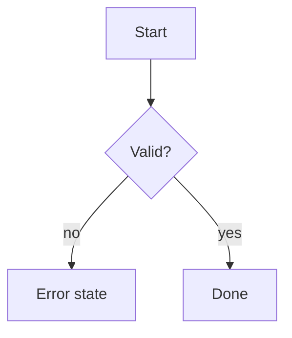

# <Feature name>

**Ticket:** <parent> · <BE> · <FE>
**Design spec:** <file, version, section>
**Last updated:** <dd.mm.yyyy>

Module-wide rules: [README.md](README.md).

## 1. Inputs
| Field | Required | Validation | Code | Test |
| ----- | -------- | ---------- | ---- | ---- |
When and in which order validation runs.

## 2. Back end
| Case | Result / error code | Code | Test |
| ---- | ------------------- | ---- | ---- |
Security rules (who may do it, whose data). APIs involved.

## 3. Front end
States, and per state the component and the exact UI text (quoted verbatim):
| State | Component | Text | Code | Test |
| ----- | --------- | ---- | ---- | ---- |
What the front end blocks without calling the API.

## 4. Navigation
Where success leads, guards, links to other features.

## 5. Open points
1. ...

## Change history
| Date | Change | Ticket |
| ---- | ------ | ------ |
